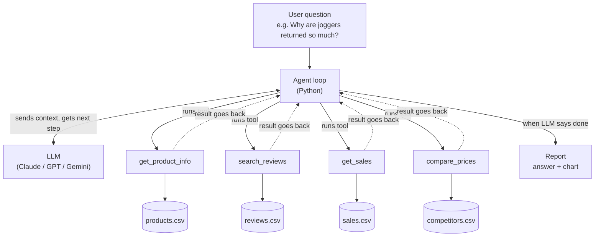

# d2c-brand-agent

### Problem

A D2C brand’s data is scattered across many places:

- Reviews on the website, Amazon, Myntra and Instagram comments
- Sales and returns in Shopify or an internal dashboard
- Product details in a catalog sheet
- Competitor prices on other brands’ websites

When someone has a business question, they jump between all of these, export to Excel, read hundreds of reviews by hand, and put a slide together. That can take hours or days, for questions like:
- “Returns on our joggers went up this month. Why?”
- “What are customers complaining about most in winter wear?”
- “Are we priced too high compared to similar brands?”
- “Which products should we restock, and which should we discount?”

### Who uses it

- Brand and category managers, who own a product line and need answers fast
- Growth and marketing teams, who want to know what customers love so they can use it in ads
- Founders and leadership, who want a quick weekly summary without opening five dashboards

## Architecture

